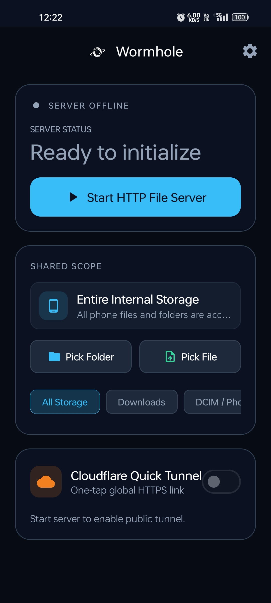
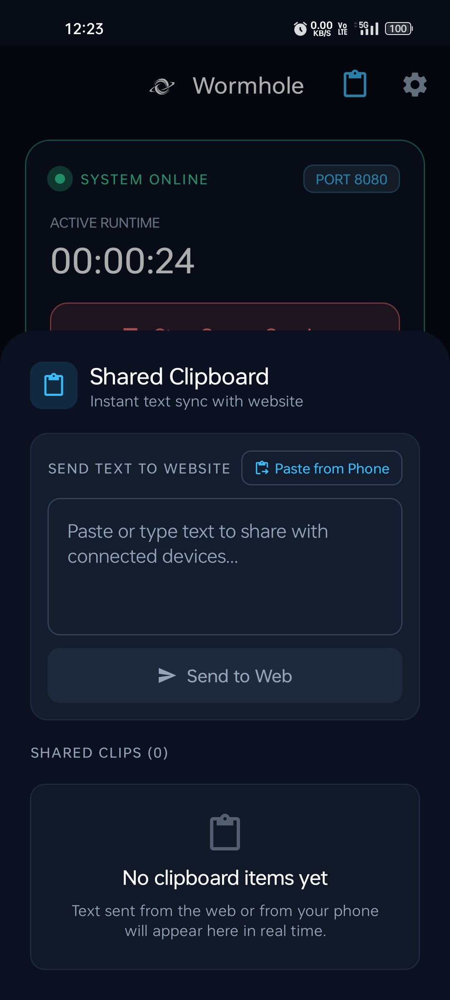
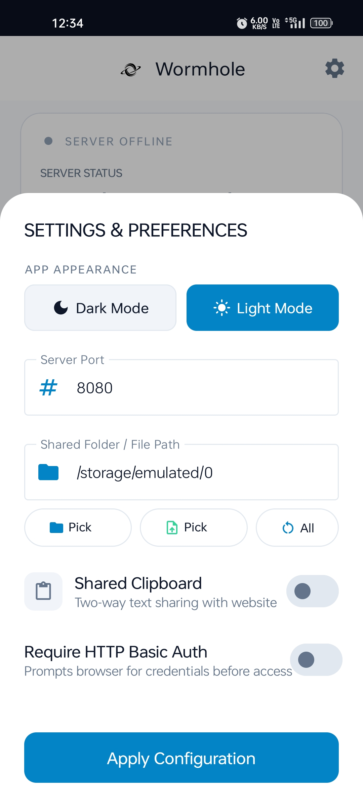
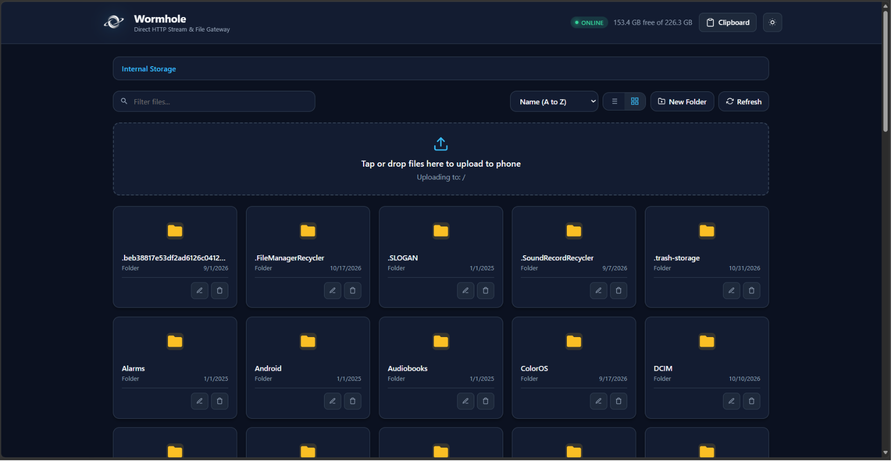
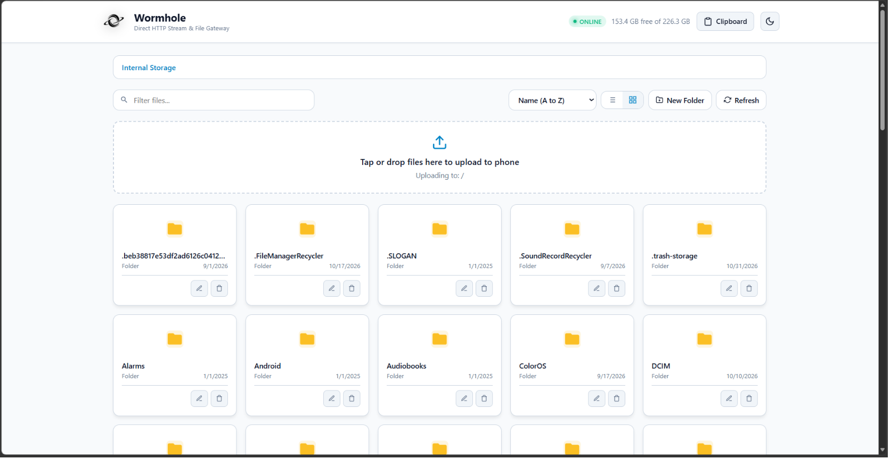

<div align="center">

  

  # 🌌 Wormhole
  ### *High-Performance Android HTTP Stream Gateway, Two-Way Shared Clipboard & Instant Global Cloudflare Tunnel*

  [-3DDC84?style=for-the-badge&logo=android&logoColor=white)](https://android.com)
  [](https://kotlinlang.org)
  [](https://developer.android.com/jetpack/compose)
  [](https://ktor.io)
  [](https://developers.cloudflare.com/cloudflare-one/connections/connect-networks/)
  [-brightgreen?style=for-the-badge)](https://github.com/Adil-Arbaz-Khan)

  <p align="center">
    <b>Wormhole</b> turns your Android phone into an ultra-fast, local and global HTTP file server and cross-device communication hub.<br/>
    Stream 4K videos with zero buffering, drag-and-drop gigabytes of files wirelessly, sync clipboards in real-time, or share with anyone worldwide using a one-tap secure Cloudflare HTTPS tunnel.
  </p>

  <p align="center">
    <a href="#-key-features">Features</a> •
    <a href="#-visual-showcase">Screenshots</a> •
    <a href="#-architecture--engineering-highlights">Architecture</a> •
    <a href="#-quick-start--build">Quick Start</a> •
    <a href="#-author--license">Author</a>
  </p>

</div>

---

## ⚡ Key Features

- 🌐 **Instant Local & Worldwide Access**:
  - **Local Wi-Fi & Hotspots**: Instant access via `http://<phone-ip>:8080`.
  - **USB Tethering & Reverse Tethering**: Zero packet drop over direct wired USB connections.
  - **One-Tap Cloudflare Quick Tunnel**: Creates a publicly accessible, SSL-secured `https://*.trycloudflare.com` URL in seconds—no router port forwarding, static IPs, or Cloudflare accounts required.

- 📋 **Bidirectional Shared Clipboard**:
  - Two-way text and link sharing between your phone and any connected web browser.
  - **Phone-to-Web**: Tap "Paste from Phone" and "Send to Web"—the text instantly appears for visitors to copy with one click.
  - **Web-to-Phone**: Web visitors can submit text or notes to the phone; an in-app unread notification counter badge alerts you in real time.
  - Fully toggleable in Settings; when disabled, all clipboard endpoints and web UI components are completely hidden.

- 🎬 **Instant HTTP 206 Media Streaming**:
  - Powered by **Ktor CIO** with byte-range partial content support (`Accept-Ranges: bytes`).
  - Instantly seek through 4K/1080p movies and music in VLC, Chrome, Safari, or the built-in inline web media player without waiting for the file to download.

- 📂 **Flexible Storage Scoping**:
  - Share your **Entire Internal Storage**, or restrict access to a **Specific Folder** (e.g. `Downloads`, `DCIM/Photos`), or isolate a **Single File**.

- 🚀 **Full-Window Drag & Drop Uploads**:
  - Upload entire folders or multiple files from your computer by dragging them anywhere onto the web browser.
  - Features real-time percentage progress indicators and transfer speed calculation.

- 🌓 **Adaptive Dark & Light Modes**:
  - Full theme engine across both the Android application and the web gateway.
  - Includes dynamically rendered universal branding, SVG iconography, and theme-adaptive tab favicons.

- 🪶 **Engineered for Lightness (20 MB Release)**:
  - Compressed via **UPX 4** (reducing the embedded `cloudflared` binary by 53%) and optimized with **R8 code and resource tree-shaking** for instant launch speeds and minimal battery drain.

---

## 📱 Visual Showcase

### Mobile Application (Jetpack Compose & Material 3)

<div align="center">
  <table>
    <tr>
      <td align="center" width="33%">
        <b>System Dashboard & Tunnel</b><br/><br/>
        
      </td>
      <td align="center" width="33%">
        <b>Two-Way Shared Clipboard</b><br/><br/>
        
      </td>
      <td align="center" width="33%">
        <b>Scope & Server Settings</b><br/><br/>
        
      </td>
    </tr>
  </table>
</div>

### Responsive Web Gateway (Zero External Dependencies)

<div align="center">
  <p><b>Dark Mode File Gateway (Stream Seek, Multi-Select, Drag & Drop, Sort & Filter)</b></p>
  
  <br/><br/>
  <p><b>Responsive Header, Dynamic Storage Bar & Theme Switcher</b></p>
  
</div>

---

## 🛠️ Architecture & Engineering Highlights

```
                                      ┌────────────────────────┐
                                      │  Public Web Visitors   │
                                      └───────────┬────────────┘
                                                  │ (HTTPS / TLS)
                                                  ▼
                                      ┌────────────────────────┐
                                      │ Cloudflare Edge Tunnel │
                                      └───────────┬────────────┘
                                                  │ (QUIC / WireGuard)
  ┌───────────────────────────────────────────────┼───────────────────────────────────────────────┐
  │ ANDROID RUNTIME                               ▼                                               │
  │                                   ┌───────────────────────┐                                   │
  │                                   │   libcloudflared.so   │                                   │
  │                                   │  (Native Go Executable)│                                  │
  │                                   └───────────┬───────────┘                                   │
  │                                               │ 127.0.0.1:8080                                │
  │ ┌───────────────────────────┐                 ▼                 ┌───────────────────────────┐ │
  │ │    Local Wi-Fi Visitors   ├────────► ┌─────────────┐ ◄────────┤   USB Tethered Visitors   │ │
  │ └───────────────────────────┘          │  Ktor (CIO) │          └───────────────────────────┘ │
  │                                        │ HTTP Server │                                        │
  │                                        └──────┬──────┘                                        │
  │                                               │                                               │
  │                     ┌─────────────────────────┼─────────────────────────┐                     │
  │                     ▼                         ▼                         ▼                     │
  │           ┌──────────────────┐      ┌──────────────────┐      ┌──────────────────┐            │
  │           │   File Storage   │      │ Shared Clipboard │      │   Embedded Web   │            │
  │           │  (Range Streams) │      │  State Flow Bus  │      │  Portal (Assets) │            │
  │           └──────────────────┘      └──────────────────┘      └──────────────────┘            │
  └───────────────────────────────────────────────────────────────────────────────────────────────┘
```

### 1. Bypassing Android 10+ W^X (SELinux Exec Restrictions)
Android 10+ (API 29+) enforces strict W^X (Write XOR Execute) memory policies on app data paths (`/data/data/<package>/files`), mounting them with `noexec` flags and preventing direct execution of downloaded binaries.

**The Solution:**
Wormhole packages `cloudflared` directly inside `app/src/main/jniLibs/arm64-v8a/libcloudflared.so` and enforces `useLegacyPackaging = true` in Gradle:
```kotlin
packaging {
    jniLibs {
        useLegacyPackaging = true // Unpacks .so with POSIX rx permissions into nativeLibraryDir
    }
}
```
The Android Package Manager unpacks `libcloudflared.so` into `context.applicationInfo.nativeLibraryDir` with executable rights, enabling clean execution via `ProcessBuilder` without root.

### 2. Embedded Zero-CDN Single Page Application
- Stored directly in `app/src/main/assets/web/index.html`.
- Requires zero external CDNs, fonts, or tracking scripts. The web gateway operates 100% offline even in remote environments (airplane mode, Wi-Fi hotspots, ad-hoc mesh).
- Incorporates native responsive CSS for tablets, desktop monitors, and mobile phones.

### 3. Foreground Service Reliability
- Bound to an Android `ForegroundService` with `PARTIAL_WAKE_LOCK` and `WifiLock` (`WIFI_MODE_FULL_HIGH_PERF`).
- Prevents Doze mode socket timeouts, allowing background 50 GB+ file transfers without interruption.

---

## 🚀 Quick Start & Build

### Prerequisites
- Android Studio Ladybug / Meerkat or Command-Line Tools
- JDK 17+
- Android SDK (API 35, Min SDK 26)

### Clone & Build Release APK
```bash
# Clone the repository
git clone https://github.com/Adil-Arbaz-Khan/Wormhole.git
cd Wormhole

# Build the optimized release APK (with R8 + UPX)
./gradlew assembleRelease
```
The optimized production APK will be generated at:
```
app/build/outputs/apk/release/app-release.apk
```

### Install onto Device via ADB
```bash
adb install -r app/build/outputs/apk/release/app-release.apk
```

---

## 👨‍💻 Author & Contact

Designed and engineered with care by **Adil Arbaz Khan**:
- **GitHub**: [@Adil-Arbaz-Khan](https://github.com/Adil-Arbaz-Khan)
- **Profile**: [https://github.com/Adil-Arbaz-Khan](https://github.com/Adil-Arbaz-Khan)

---

## 📄 License

```
Copyright (c) 2026 Adil Arbaz Khan

Licensed under the Apache License, Version 2.0 (the "License");
you may not use this file except in compliance with the License.
You may obtain a copy of the License at

    http://www.apache.org/licenses/LICENSE-2.0

Unless required by applicable law or agreed to in writing, software
distributed under the License is distributed on an "AS IS" BASIS,
WITHOUT WARRANTIES OR CONDITIONS OF ANY KIND, either express or implied.
See the License for the specific language governing permissions and
limitations under the License.
```
