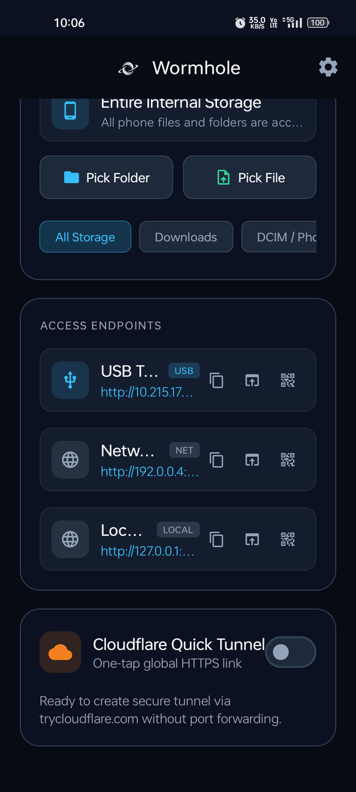

<div align="center">

  

  # 🌌 Wormhole v2 
  ### *High-Performance Android HTTP Gateway, Dual-Mode Remote Storage Server & Instant Global Cloudflare Tunnel*

  [-3DDC84?style=for-the-badge&logo=android&logoColor=white)](https://android.com)
  [](https://github.com/Adil-Arbaz-Khan)
  [](https://kotlinlang.org)
  [](https://developer.android.com/jetpack/compose)
  [](https://ktor.io)
  [](https://developers.cloudflare.com/cloudflare-one/connections/connect-networks/)
  [-brightgreen?style=for-the-badge)](https://github.com/Adil-Arbaz-Khan)

  <p align="center">
    <b>Wormhole</b> turns your Android device into an ultra-fast local and global HTTP file server, real-time cross-device communication hub, and headless personal storage cloud.<br/>
    Stream 4K videos with zero buffering, monitor transfer bandwidth and active visitors in real time, sync clipboards seamlessly, or securely access your home storage host from anywhere in the world.
  </p>

  <p align="center">
    <a href="releases/Wormhole-v2.0.0.apk"><b></b></a>
  </p>

  <p align="center">
    <a href="#-dual-mode-product-architecture">Modes</a> •
    <a href="#-key-features">Features</a> •
    <a href="#-visual-showcase">Screenshots</a> •
    <a href="#-architecture--engineering-highlights">Architecture</a> •
    <a href="#-quick-start--build">Quick Start</a> •
    <a href="#-author--license">Author</a>
  </p>

</div>

---

## 🌟 Dual-Mode Product Architecture

Wormhole v2.0 introduces an advanced dual-mode architecture while preserving the frictionless zero-account sharing experience at its heart.

### 🚀 Mode A — Standard Sharing (Primary & Default Experience)
*Designed for quick, frictionless peer-to-peer file sharing without accounts or registration.*
- **Zero Registration**: Open the app, select your files or storage scope, tap **Start Server**, and share your link.
- **Live Bandwidth & Telemetry Dashboard**: Real-time sliding-window upload and download speed meters (`B/s`, `KB/s`, `MB/s`), cumulative byte transfer counters, active socket connection tracking, and unique visitor metrics.
- **Recent Activity Feed**: In-memory rolling ring buffer tracking streams, downloads, folder creations, and clipboard exchanges.
- **Instant Cloudflare Quick Tunnel**: One-tap public HTTPS URL (`https://*.trycloudflare.com`) accessible worldwide without router port forwarding.

### 🛡️ Mode B — Remote Server Mode (Optional Advanced Feature)
*Designed for users who keep an Android phone at home as a dedicated, remotely managed personal storage server.*
- **Headless Host Toggle**: Controlled via a clear `[OFF / ON]` switch in Settings (default OFF).
- **Persistent Device Identity**: Unique cryptographic host ID backed by Android Keystore.
- **Remote Administrator Login**: Manage Phone B from Phone A over local network or Cloudflare tunnel.
- **Remote Host Telemetry**: Monitor battery charge percentage, battery temperature (°C), charging state, storage capacity, and network interface status.
- **Remote Storage Browser**: Full file navigation with metadata, breadcrumb exploration, search, and directory traversal.
- **Cryptographic Tokenized Shares (`/s/{token}`)**:
  - Raw filesystem paths are never exposed.
  - Salted PBKDF2 with HMAC-SHA256 password protection.
  - Configurable expiration timestamps and view limits.
  - Stream-only vs full download permissions.
  - Instant one-tap link revocation (`DELETE /api/admin/shares/{id}`).

---

## ⚡ Key Features

- 🌐 **Instant Local & Worldwide Access**:
  - **Local Wi-Fi & Hotspots**: Instant access via `http://<phone-ip>:8080`.
  - **USB Tethering & Reverse Tethering**: Zero packet drop over direct wired USB connections.
  - **One-Tap Cloudflare Quick Tunnel**: SSL-secured `https://*.trycloudflare.com` URL in seconds—no port forwarding, static IPs, or Cloudflare accounts required.

- 📊 **Real-Time Operational Telemetry**:
  - Sliding-window bandwidth calculation with instantaneous atomic counters.
  - Live visitor session tracking via client IP hashing.
  - Comprehensive sharing event logging with dedicated bottom sheets.

- 📋 **Bidirectional Shared Clipboard**:
  - Two-way text and link sharing between your phone and any connected web browser.
  - **Phone-to-Web**: Tap "Paste from Phone" and "Send to Web"—text appears instantly on the web gateway.
  - **Web-to-Phone**: Web visitors submit text notes; an in-app unread notification badge alerts you in real time.
  - Fully toggleable in Settings; clipboard operates independently of read-only file protection.

- 🔒 **Granular Security Controls**:
  - **Read-Only Mode**: Prevents file rename, folder creation, and deletion from the web browser while permitting downloads and stream previews.
  - **Upload Protection**: Toggle to disallow browser uploads entirely.
  - **HTTP Basic Authentication**: Password protection with password visibility toggle.

- 🎬 **Instant HTTP 206 Media Streaming**:
  - Powered by **Ktor CIO** with byte-range partial content support (`Accept-Ranges: bytes`).
  - Instantly seek through 4K/1080p movies and music in VLC, Chrome, Safari, or the built-in web media player without waiting for the file to download.

- 🪶 **Engineered for Lightness (20.2 MB Release)**:
  - Compressed via **UPX 4** (reducing embedded `cloudflared` by 53%) and optimized with **R8 full-mode tree-shaking** for instant launch and minimal battery drain.

---

## 📱 Visual Showcase

### Mobile Application (Jetpack Compose & Material 3)

<div align="center">
  <table>
    <tr>
      <td align="center" width="33%">
        <b>System Dashboard & Tunnel</b><br/><br/>
        
      </td>
      <td align="center" width="33%">
        <b>Live Bandwidth & Telemetry</b><br/><br/>
        
      </td>
      <td align="center" width="33%">
        <b>Settings Pannel</b><br/><br/>
        
      </td>
    </tr>
  </table>
</div>

### Responsive Web Gateway (Zero External Dependencies)

<div align="center">
  <p><b>Dark Mode File Gateway (Stream Seek, Multi-Select, Drag & Drop, Sort & Filter)</b></p>
  
  <br/><br/>
  <p><b>Responsive Header, Dynamic Storage Bar & Theme Switcher</b></p>
  
</div>

---

## 🛠️ Architecture & Engineering Highlights

```
                                      ┌────────────────────────┐
                                      │  Public Web Visitors   │
                                      └───────────┬────────────┘
                                                  │ (HTTPS / TLS)
                                                  ▼
                                      ┌────────────────────────┐
                                      │ Cloudflare Edge Tunnel │
                                      └───────────┬────────────┘
                                                  │ (QUIC / WireGuard)
  ┌───────────────────────────────────────────────┼───────────────────────────────────────────────┐
  │ ANDROID HOST DEVICE (PHONE B)                 ▼                                               │
  │                                   ┌───────────────────────┐                                   │
  │                                   │   libcloudflared.so   │                                   │
  │                                   │  (Native Go Executable)│                                  │
  │                                   └───────────┬───────────┘                                   │
  │                                               │ 127.0.0.1:8080                                │
  │ ┌───────────────────────────┐                 ▼                 ┌───────────────────────────┐ │
  │ │    Local Wi-Fi Visitors   ├────────► ┌─────────────┐ ◄────────┤   Remote Administrator    │ │
  │ └───────────────────────────┘          │  Ktor (CIO) │          │   (Phone A / Web Client)  │ │
  │                                        │ HTTP Server │          └───────────────────────────┘ │
  │                                        └──────┬──────┘                                        │
  │                                               │                                               │
  │      ┌─────────────────────────┬──────────────┴────────────────┬────────────────────────┐     │
  │      ▼                         ▼                               ▼                        ▼     │
  │ ┌──────────────┐      ┌──────────────────┐           ┌──────────────────┐     ┌──────────────┐│
  │ │ File Storage │      │ Shared Clipboard │           │ Cryptographic    │     │ Live Traffic ││
  │ │ Range Stream │      │  State Flow Bus  │           │ Shares SQLite DB │     │ & Activity   ││
  │ └──────────────┘      └──────────────────┘           └──────────────────┘     └──────────────┘│
  └───────────────────────────────────────────────────────────────────────────────────────────────┘
```

### 1. Bypassing Android 10+ W^X (SELinux Exec Restrictions)
Android 10+ (API 29+) enforces strict W^X memory policies on app data paths (`/data/data/<package>/files`), mounting them with `noexec` flags and preventing direct execution of downloaded binaries.

**The Solution:**
Wormhole packages `cloudflared` directly inside `app/src/main/jniLibs/arm64-v8a/libcloudflared.so` and enforces `useLegacyPackaging = true` in Gradle:
```kotlin
packaging {
    jniLibs {
        useLegacyPackaging = true // Unpacks .so with POSIX rx permissions into nativeLibraryDir
    }
}
```
The Android Package Manager unpacks `libcloudflared.so` into `context.applicationInfo.nativeLibraryDir` with executable rights, enabling clean execution via `ProcessBuilder` without root.

### 2. High-Performance Sliding Window Telemetry
Bandwidth measurement is computed using atomic counters coupled with a decaying sliding-window rate calculation, ensuring real-time speed gauges without impacting Ktor's non-blocking I/O throughput.

### 3. Foreground Service Reliability
- Bound to an Android `ForegroundService` with `PARTIAL_WAKE_LOCK` and `WifiLock` (`WIFI_MODE_FULL_HIGH_PERF`).
- Prevents Doze mode socket timeouts, allowing background 50 GB+ file transfers without interruption.

---

## 🚀 Quick Start & Build

### Prerequisites
- Android Studio Ladybug / Meerkat or Command-Line Tools
- JDK 17+
- Android SDK (API 35, Min SDK 26)

### Clone & Build Release APK
```bash
# Clone the repository
git clone https://github.com/Adil-Arbaz-Khan/Wormhole-file-server.git
cd Wormhole-file-server

# Build the optimized release APK (with R8 + UPX)
./gradlew assembleRelease
```
The optimized production APK will be generated at:
```
app/build/outputs/apk/release/app-release.apk
```

### Install onto Device via ADB
```bash
# Direct install from the repository release binary
adb install -r releases/Wormhole-v2.0.0.apk

# Or install local build
adb install -r app/build/outputs/apk/release/app-release.apk
```

---

## 👨‍💻 Author & Contact

Designed and engineered with care by **Adil Arbaz Khan**:
- **GitHub**: [@Adil-Arbaz-Khan](https://github.com/Adil-Arbaz-Khan)
- **Profile**: [https://github.com/Adil-Arbaz-Khan](https://github.com/Adil-Arbaz-Khan)

---

## 📄 License

```
Copyright (c) 2026 Adil Arbaz Khan

Licensed under the Apache License, Version 2.0 (the "License");
you may not use this file except in compliance with the License.
You may obtain a copy of the License at

    http://www.apache.org/licenses/LICENSE-2.0

Unless required by applicable law or agreed to in writing, software
distributed under the License is distributed on an "AS IS" BASIS,
WITHOUT WARRANTIES OR CONDITIONS OF ANY KIND, either express or implied.
See the License for the specific language governing permissions and
limitations under the License.
```
